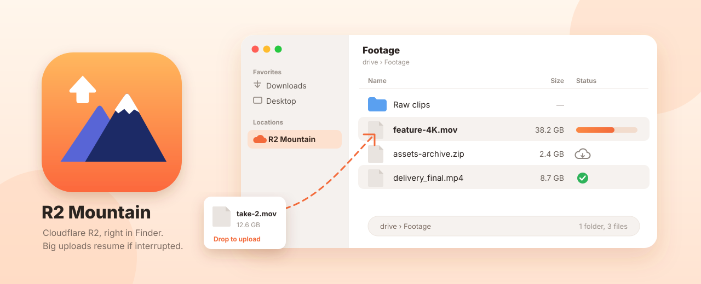
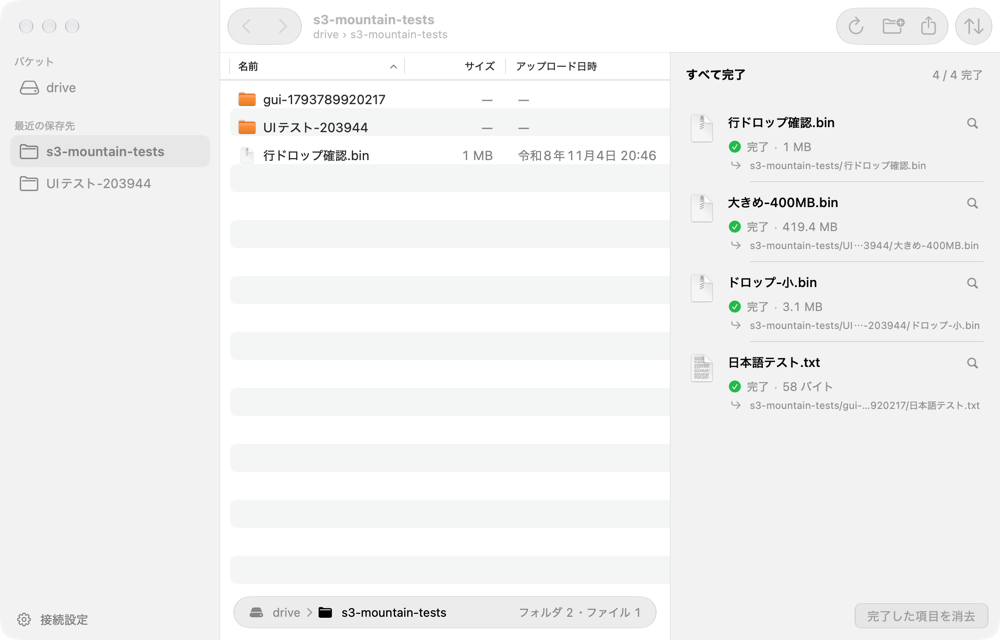
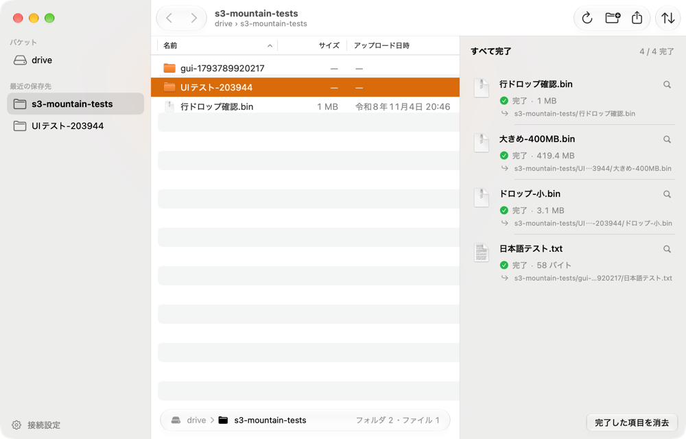
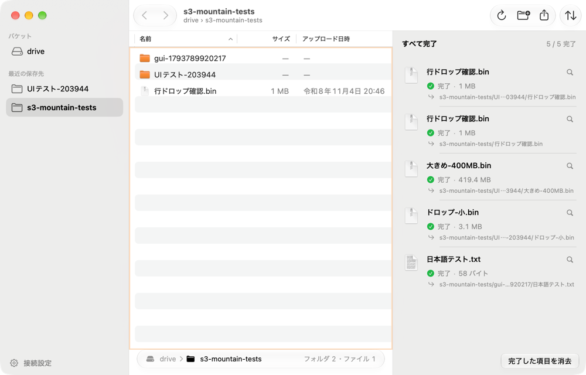
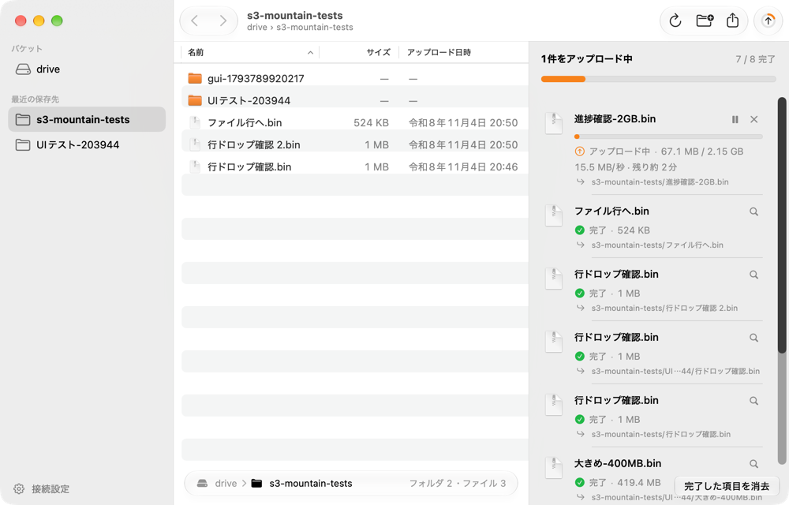
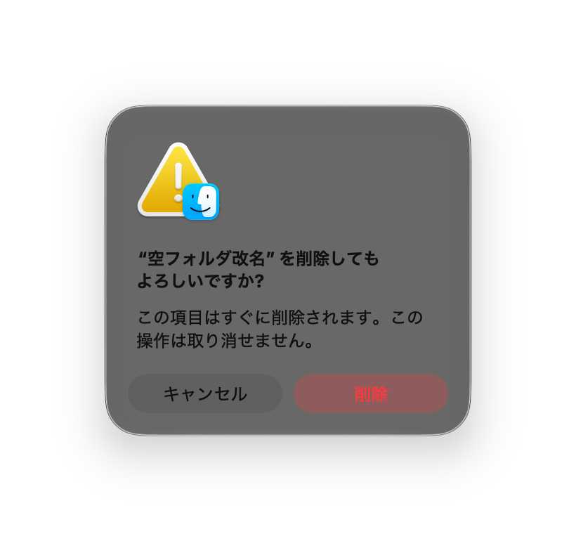

<div align="center">



# R2 Mountain

Cloudflare R2 in Finder

**Cloudflare R2 を、Finder のふつうの場所に。**<br>
大きなファイルもドラッグするだけ。途中で止まっても続きから送ります。

Cloudflare R2 専用の macOS アプリです。<br>
バケットを Finder のサイドバーに表示し、メニューバーとウィンドウからもアップロードできます。

<sub>R2 のダッシュボードでは大きなファイルを上げられないため、自分の Mac で使うために作りました。</sub>

[](#-はじめかた)
[](#-構成)
[](#-できること)
[](#%EF%B8%8F-finder-での操作)
[](#-画面)

**[はじめかた](#-はじめかた)**&emsp;**[できること](#-できること)**&emsp;**[Finder での操作](#%EF%B8%8F-finder-での操作)**&emsp;[構成](#-構成)

</div>

> [!NOTE]
> 旧名：S3 Mountain。設定、資格情報、Finder の連携を引き継ぐため、Bundle ID（`run.kan.s3mountain`）、App Group、Keychain のグループは変えていません。

## 🎬 画面

<div align="center">

<table>
  <tr>
    <td align="center" width="33%"></td>
    <td align="center" width="33%"></td>
    <td align="center" width="33%"></td>
  </tr>
  <tr>
    <td align="center"><b>📁 フォルダを選ぶ</b><br>Finder と同じ一覧で<br>保存先を開く</td>
    <td align="center"><b>🎯 行にドロップ</b><br>重ねたフォルダへ<br>アップロード</td>
    <td align="center"><b>⬇️ どこでもドロップ</b><br>表示中のフォルダへ<br>アップロード</td>
  </tr>
  <tr>
    <td align="center"></td>
    <td align="center"></td>
    <td align="center"> </td>
  </tr>
  <tr>
    <td align="center"><b>📈 進捗と残り時間</b><br>速度、残り時間、<br>一時停止と再開</td>
    <td align="center"><b>🗑️ 確認つきの削除</b><br>Finder の「すぐに削除」で<br>R2 からも削除</td>
    <td align="center"><b>🏔️ アイコン</b><br>Liquid Glass のレイヤーで<br>ライトとダークに対応</td>
  </tr>
</table>

<sub>画面は macOS 27.2 で撮影しました（2026年11月4〜5日）。ファイル名はテスト用です。</sub>

</div>

## ✨ できること

- 🗂️ **Finder にマウント** — バケットが Finder のサイドバーの「場所」に表示され、ほかのフォルダと同じように開く、コピーする、名前を変える、移動する、削除するができます
- ⬆️ **大きなファイルも続きから** — 64 MiB 以上はマルチパートで送り、途中で止まっても、送れたパートを確かめてから残りだけ送ります
- 🪶 **ディスクを二重に使わない** — Finder からアップロードしたファイルは、終わると Mac 側のコピーを自動で解放します。開くと R2 からダウンロードし直します
- 📁 **保存先を選んでドロップ** — アプリのウィンドウでフォルダを開いてドロップ、またはメニューバーから選んでアップロード。新規フォルダもその場で作れます
- 🔒 **見えていないものは消さない** — Finder にまだ出ていないファイルが R2 にあるフォルダは、削除を取りやめて中身を表示し直します
- 🧭 **上書きしない** — 名前がぶつかったら、合流も上書きもせずに「名前 2」にします
- 🔑 **シークレットは Keychain** — アクセスキーのシークレットは Keychain（アプリと拡張機能で共有するグループ）にだけ保存します
- 🔔 **進捗と通知** — 速度と残り時間、完了と失敗の通知、問題があるときはメニューバーのアイコンが変わります

## 🗂️ Finder での操作

| Finder でしたこと | R2 で起きること |
| --- | --- |
| フォルダを開く | そのフォルダを一覧します（`ListObjectsV2`） |
| ファイルを開く、コピーする | R2 からダウンロードします |
| ファイルやフォルダをドラッグ | アップロードします。終わると Mac 側のコピーを解放します |
| 新規フォルダ | `名前/` のフォルダ（マーカー）を作ります |
| 名前を変える、移動する | 新しいキーにコピーしてから元を削除します（5 GiB を超えるファイルは分割コピー） |
| すぐに削除（⌥⌘⌫） | 確認のあと削除します。フォルダは中身ごと削除します |
| ほかの手段で R2 を変更 | アプリの起動中は約90秒ごとに確かめて、Finder に反映します |

> [!IMPORTANT]
> ゴミ箱は使いません。⌘⌫（ゴミ箱に入れる）では何も起きないので、右クリックか ⌥⌘⌫ の「すぐに削除」を使ってください。

> [!TIP]
> R2 には名前変更の操作がないため、大きなフォルダの名前変更や移動は、中身をすべてコピーし終えるまで時間がかかります。

## 🚀 はじめかた

### 1. ビルドして起動

macOS 26 以降、Xcode 27（Swift 6）、[just](https://github.com/casey/just)、[XcodeGen](https://github.com/yonaskolb/XcodeGen) を使います。

```sh
git clone https://github.com/kandotrun/r2-mountain.git
cd r2-mountain
just run
```

> [!NOTE]
> Finder 連携の拡張機能には開発用の署名が必要です。署名チームは `project.yml` の `DEVELOPMENT_TEAM` で指定します。
> 初回の `just run`（`just build-signed`）は、自動署名のためにこの Mac を Apple Developer のデバイスとして登録します。

### 2. R2 の API トークンを用意する

<details>
<summary>トークンの作り方</summary>

1. Cloudflare のダッシュボードで R2 を開き、API トークンの管理から新しいトークンを作ります。
2. 権限は「オブジェクトの読み取りと書き込み」にし、使うバケットを指定します。
3. 作成後に表示される **アクセスキー ID** と **シークレットアクセスキー** を控えます（シークレットはこの画面でしか表示されません）。
4. R2 の画面に出ている **アカウント ID** も控えます。アクセスキー ID とは別の値です。

</details>

### 3. 接続して Finder に表示する

1. メニューバーの山のアイコンから「接続設定…」を開き、アカウント ID、バケット、アクセスキー ID、シークレットを保存します。
2. 「Finder に表示」をオンにします。
3. Finder のサイドバーの「場所」に **R2 Mountain** が出ます（`~/Library/CloudStorage/R2Mountain-<バケット>`）。

Debug ビルドは File Provider の Testing Mode を使うため、システム設定で拡張機能をオンにする操作はいりません。

## ⌨️ ウィンドウのキーボード操作

| 操作 | キー |
| --- | --- |
| フォルダを開く | Return または ⌘↓ |
| 上の階層へ | ⌘↑ |
| 戻る、進む | ⌘[ 、⌘] |
| 新規フォルダ | ⇧⌘N |
| ファイルを選んでアップロード | ⌘O |
| 再読み込み | ⌘R |

## 🧱 構成

| 部分 | 内容 |
| --- | --- |
| `Packages/MountainCore` | R2 用の S3 クライアント（SigV4）、再開できるアップロード、Finder 用の項目の対応表（SQLite）と操作。UI に依存せず `swift test` で検証 |
| `App` | SwiftUI と AppKit のアプリ。メニューバー、メインウィンドウ、設定、Finder 連携の管理 |
| `FileProvider` | File Provider の拡張機能。Apple の API と MountainCore の橋渡しだけを行う |
| `Shared` | アプリと拡張機能で共有する接続先と資格情報 |

```
App/            # メニューバー、ウィンドウ、設定、Finder 連携の切り替え、アプリアイコン（AppIcon.icon）
FileProvider/   # replicated extension（列挙、ダウンロード、作成、変更、削除）
Shared/         # App Group の接続先、共有 Keychain
Packages/MountainCore/
  Sources/MountainCore/
    S3/         # 署名、要求、XML、ダウンロード、コピー、一括削除
    Upload/     # メニューバー版のアップロードエンジン、表示用の文言
    Browse/     # フォルダのパス、一覧、履歴、最近の保存先
    Mount/      # 項目の対応表と変更履歴、キーを変えないアップロード、移動と削除
    Host/       # Finder のドメインの登録と定期確認
  Tests/        # Swift Testing の単体テスト
scripts/        # 実 R2 での検証ツール（開発用）
docs/           # 仕様書、実装計画、検証記録
```

## 🧪 開発

```sh
just test          # MountainCore の単体テスト（認証情報は不要）
just lint          # swift format による静的検査
just build-signed  # 開発用署名でビルド
just run           # ビルドして起動
```

実 R2 での検証の手順は [実 R2 の検証手順](docs/r2-integration-testing.md) にあります。テスト用のオブジェクトは `s3-mountain-tests/` の下だけに作り、作ったキーだけを片付けます。

## ✅ 確認済みと、正直な限界

確認済み（macOS 27.2、実際の R2 バケット）:

- **Finder**: 一覧、ダウンロード（MD5 一致）、3 MB と 150 MB のアップロード、アップロード後の解放、新規フォルダ、ファイルとフォルダの名前変更・移動、確認つきの削除、R2 側の追加・削除の反映
- **安全性**: 見えていないファイルがあるフォルダの削除の取りやめ、名前がぶつかったときの「名前 2」
- **アプリ**: 2 GiB のアップロード、フォルダの行と表示中のフォルダへのドロップ、キーボード操作
- **転送コア**: 強制終了からの再開（512 MiB、ダウンロードして SHA-256 一致）
- **テスト**: `just test` で 239 件

まだ確認していないこと:

- Finder 経由での数十 GB のアップロード、スリープからの復帰
- VoiceOver での全画面の操作
- Finder のタグや拡張属性は R2 に保存しません

詳しくは [検証記録](docs/validation.md) にあります。

## 📚 ドキュメント

| 文書 | 内容 |
| --- | --- |
| [フェーズ1仕様書](docs/superpowers/specs/2026-11-04-s3-mountain-phase1-design.md) | メニューバー版のアップローダー |
| [フェーズ1実装計画](docs/superpowers/plans/2026-11-04-s3-mountain-phase1-implementation.md) | 同上の実装手順 |
| [フェーズ2仕様書](docs/superpowers/specs/2026-11-05-s3-mountain-phase2-finder-mount-design.md) | Finder マウント（File Provider） |
| [フェーズ2実装計画](docs/superpowers/plans/2026-11-05-s3-mountain-phase2-finder-mount.md) | 同上の実装手順 |
| [実 R2 の検証手順](docs/r2-integration-testing.md) | 認証情報を使う検証の進め方 |
| [検証記録](docs/validation.md) | 実機と実 R2 で確かめた結果 |

## 📄 ライセンス

未定（個人用）。
